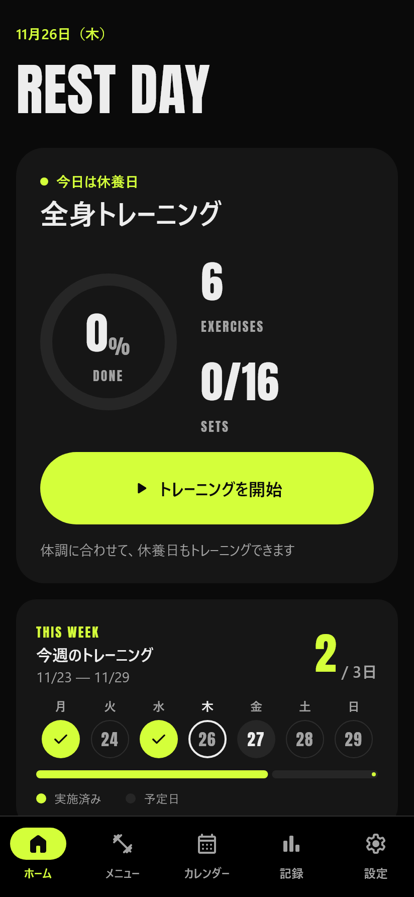
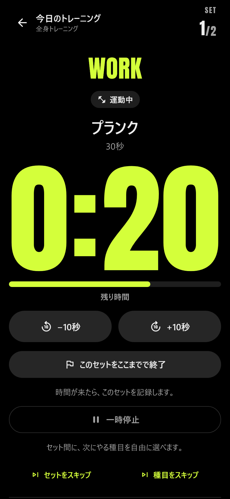
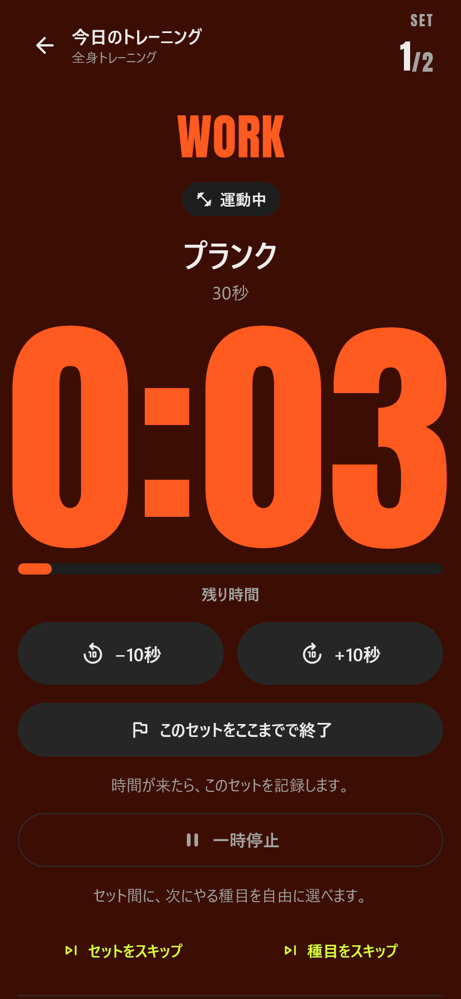
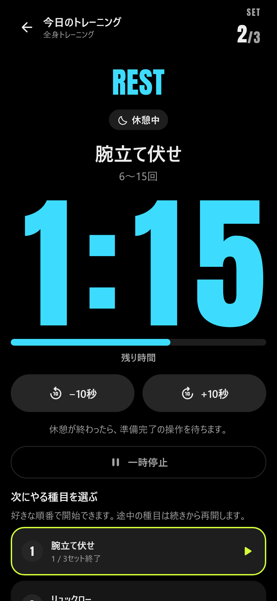
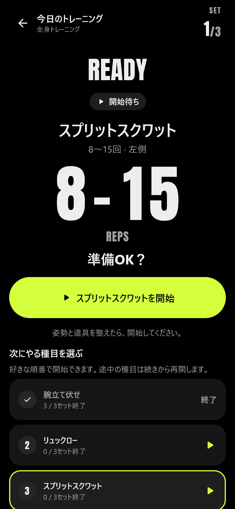
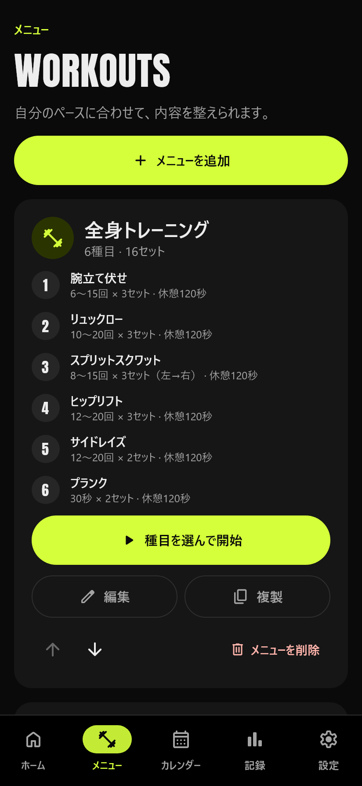
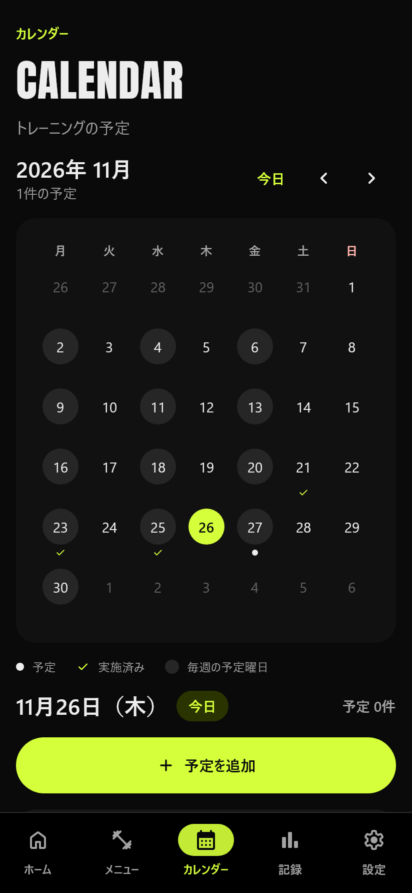
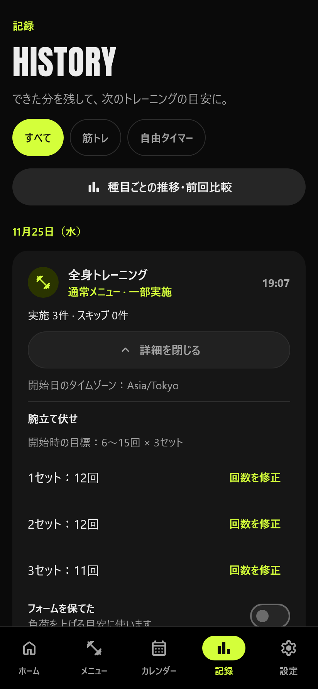

# つづトレ

**「続ける」を最優先にした、自宅向けの筋トレタイマー＋習慣化アプリ（Android）**

<p align="center">
  
  
  
  
</p>

## 概要

自宅で筋トレを続けるための、Kotlin／Jetpack Compose製のAndroidアプリです（Android 8.0以上）。登録・広告・課金・サーバーはなく、ネット接続なしで動きます。

- **入力は1セット1タップ**：回数の記録は任意です。セット間に好きな種目を選べるほか、短縮メニュー、休養日のトレーニング、初週は全種目2セットなど、続けるハードルを下げる作りにしています。
- **画面を消しても止まらないタイマー**：計測はフォアグラウンドサービスで続け、効果音・振動・日本語音声で区切りを知らせます。画面の更新は表示の秒が変わったときだけにして、動作を軽くしています。
- **夜の自宅トレーニングに合わせたデザイン**：常にダーク表示です。床に置いたスマホからでも読める画面幅いっぱいの数字と、残り3秒の色の変化で、次の動きが分かります。
- **テストしやすい作り**：タイマーの中心部分をAndroidから切り離し、JVMのユニットテスト113件で確認しています。PC版で同じ画面を動かし、画面の画像も自動で書き出します。

**使っている技術**：Kotlin、Jetpack Compose、Material 3、Room、DataStore、フォアグラウンドサービス、Compose Multiplatform（PCデバッグ版）

<details>
<summary>ほかの画面（開始前・メニュー・カレンダー・記録）</summary>
<p align="center">
  
  
  
  
</p>
</details>

画面の画像は、PC版のテストでスマホと同じ大きさ（412×892dp）に描画したものです（実機のスクリーンショットではありません）。

## 使い方

### アプリを入れる

Android Studio（JDK 17、Android SDK 36）でこのリポジトリを開き、`app`を実行します。

コマンドで入れる場合は、スマホの開発者向けオプションで「USBデバッグ」をONにしてPCにつなぎ、リポジトリ直下で次を実行します（macOS・Linuxでは`./gradlew installRelease`）。環境変数`ANDROID_HOME`には、Android SDKの場所を設定しておきます。

```powershell
.\gradlew.bat installRelease
```

初回のビルドでは、ライブラリの取得にネット接続が必要です。署名用の鍵は、初回のビルドで自動的に作られます。

### トレーニングする

1. ホームの「トレーニングを開始」を押し、始める種目をタップします。すぐに始まります。
2. 回数制の種目は、終わったら「セット完了」を押します。時間制の種目は、カウントダウンが終わると自動で記録します。回数も残したいときだけ「＋ 回数も記録する（任意）」を使います。
3. セットの間は休憩タイマーが動きます。次にやる種目は好きな順に選べます。
4. 途中でやめるときは「今日はここで終了する」を押します。できた分が記録に残ります。

### そのほかの機能

- **メニュー**：種目・セット数・目標・休憩時間を編集し、並べ替えます。
- **カレンダー**：日付ごとにメニューと時刻を決めて、予定を追加します。
- **記録**：日付ごとの実績を見て、回数の入力・修正や、間違えた記録の削除ができます。
- **設定**：トレーニングする曜日、週間目標、リマインド通知、合図（効果音・振動・音声）、バックアップの書き出し・取り込みを設定します。
- **自由タイマー**：ホームの「インターバルを設定」から、運動・休憩・ラウンド数を決めて自動で進めます（初期値は20秒＋10秒×8回）。
